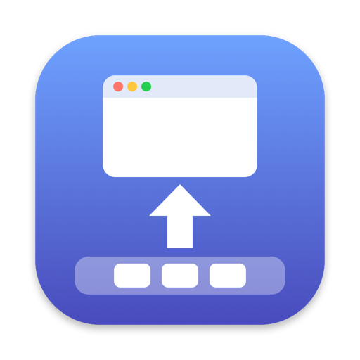

<p align="center">
  
</p>

<h1 align="center">EleDock</h1>

<p align="center"><em>ウインドウを、エレガントに Dock へ。</em></p>

<p align="center">
  <a href="https://sijunkim.github.io/EleDock/?lang=ja"><b>Web サイト</b></a> ·
  <a href="https://github.com/sijunkim/EleDock/releases/latest/download/EleDock.dmg"><b>ダウンロード</b></a> ·
  <a href="README.md">English</a> · <a href="README.ko.md">한국어</a> · 日本語
</p>

---

EleDock は、Mac のメニューバーに置く小さなアプリです。
<kbd>⌘</kbd><kbd>M</kbd> で前面のウインドウを Dock にしまい、<kbd>⇧</kbd><kbd>⌘</kbd><kbd>M</kbd> で最後にしまったウインドウを戻します。

## できること

- 押すたびに、前面のウインドウからその後ろへ、アプリを問わず1つずつしまいます。
- 最後にしまったウインドウから戻ります。
- ショートカットを押し続けると、ウインドウを続けてしまったり戻したりし、離すと止まります。
- どちらのショートカットも変更でき、同じキーを使っている実行中のアプリも表示します。
- 除外したアプリが最前面にあるときは、そのアプリのショートカットがそのまま使え、そのウインドウには触れません。
- メニューバーから、しまったウインドウを確認し、まとめて復元できます。ログイン時に開くこともでき、アップデートも自動で確認します。

## インストール

1. [EleDock.dmg](https://github.com/sijunkim/EleDock/releases/latest/download/EleDock.dmg) をダウンロードして開きます。
2. EleDock をダブルクリックすると、“アプリケーション”フォルダへの移動とインストールディスクの片付けを確認します。
3. **システム設定 › プライバシーとセキュリティ › アクセシビリティ** で EleDock をオンにします。ほかのアプリのウインドウをしまったり戻したりするために必要です。

macOS 13 Ventura 以降の Apple シリコン搭載 Mac と Intel 搭載 Mac で動作します。Apple の公証を受けており、日本語・英語・韓国語に対応しています。

## ソースからビルド

```sh
./build.sh          # build/EleDock.app を作成 (universal)
swift test          # テストを実行
```

Swift 6.2 を含む Xcode コマンドラインツールが必要です。

## ライセンス

[MIT](LICENSE)
