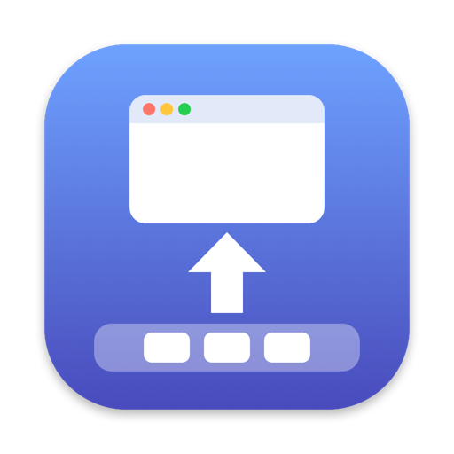

<p align="center">
  
</p>

<h1 align="center">EleDock</h1>

<p align="center"><em>창을 우아하게, Dock으로.</em></p>

<p align="center">
  <a href="https://sijunkim.github.io/EleDock/?lang=ko"><b>웹사이트</b></a> ·
  <a href="https://github.com/sijunkim/EleDock/releases/latest/download/EleDock.dmg"><b>다운로드</b></a> ·
  <a href="README.md">English</a> · 한국어 · <a href="README.ja.md">日本語</a>
</p>

---

EleDock은 Mac 메뉴 막대의 작은 앱입니다.
<kbd>⌘</kbd><kbd>M</kbd>을 누르면 맨 앞 창이 Dock으로 내려가고, <kbd>⇧</kbd><kbd>⌘</kbd><kbd>M</kbd>을 누르면 마지막에 내린 창이 돌아옵니다.

## 하는 일

- 누를 때마다 맨 앞 창부터 그 뒤의 창까지, 앱을 가리지 않고 하나씩 최소화합니다.
- 가장 최근에 최소화한 창이 먼저 돌아옵니다.
- 단축키를 누르고 있으면 창이 이어서 최소화되거나 복원되고, 손을 떼면 멈춥니다.
- 두 단축키 모두 바꿀 수 있고, 같은 키를 쓰는 실행 중인 앱도 알려 줍니다.
- 제외한 앱이 맨 앞에 있으면 그 앱의 단축키가 그대로 동작하고, 그 앱의 창은 건드리지 않습니다.
- 메뉴 막대에서 최소화된 창을 확인하고 한 번에 모두 복원합니다. 로그인 시 열 수 있고, 업데이트도 스스로 확인합니다.

## 설치

1. [EleDock.dmg](https://github.com/sijunkim/EleDock/releases/latest/download/EleDock.dmg)를 내려받아 엽니다.
2. EleDock을 더블클릭하면 응용 프로그램 폴더로 옮기고 설치 디스크를 정리할지 묻습니다.
3. **시스템 설정 › 개인정보 보호 및 보안 › 손쉬운 사용**에서 EleDock을 켭니다. 다른 앱의 창을 최소화하고 복원하는 데 필요합니다.

macOS 13 Ventura 이상, Apple 실리콘과 Intel Mac에서 동작합니다. Apple의 공증을 거쳤으며 한국어, 영어, 일본어를 지원합니다.

## 소스에서 빌드

```sh
./build.sh          # build/EleDock.app 생성 (universal)
swift test          # 테스트 실행
```

Swift 6.2가 포함된 Xcode 명령줄 도구가 필요합니다.

## 라이선스

[MIT](LICENSE)
