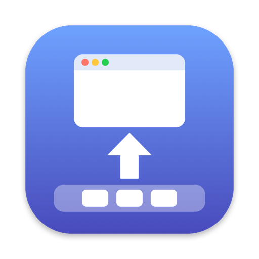

<p align="center">
  
</p>

<h1 align="center">EleDock</h1>

<p align="center"><em>Windows, elegantly into the Dock.</em></p>

<p align="center">
  <a href="https://sijunkim.github.io/EleDock/"><b>Website</b></a> ·
  <a href="https://github.com/sijunkim/EleDock/releases/latest/download/EleDock.dmg"><b>Download</b></a> ·
  English · <a href="README.ko.md">한국어</a> · <a href="README.ja.md">日本語</a>
</p>

---

EleDock is a small menu bar app for Mac.
<kbd>⌘</kbd><kbd>M</kbd> sends windows to the Dock one at a time, and <kbd>⇧</kbd><kbd>⌘</kbd><kbd>M</kbd> brings them back, most recent first.

## What it does

- **One at a time** — Each press minimizes the front window, then the one behind it, across every app.
- **Back in order** — The most recently minimized window returns first.
- **Hold to repeat** — Keep holding a shortcut to minimize or restore one window every 0.25 seconds.
- **Your own keys** — Change either shortcut. EleDock shows which running apps use the same keys.
- **Excluded apps** — When an excluded app is in front, its own shortcuts work as usual and its windows are left alone.
- **In the menu bar** — See minimized windows and restore them all at once. It can open at login and checks for updates on its own.

## Install

1. Download [EleDock.dmg](https://github.com/sijunkim/EleDock/releases/latest/download/EleDock.dmg) and open it.
2. Double-click EleDock in the window. It asks to move itself to the Applications folder, then whether to eject the installer disk and move the DMG file to the Trash.
3. Turn on EleDock in **System Settings › Privacy & Security › Accessibility**. This lets it minimize and restore windows of other apps.

Requires macOS 13 Ventura or later, on Apple Silicon or Intel. EleDock is notarized by Apple, and is available in English, Korean, and Japanese.

## Build from source

```sh
./build.sh          # builds build/EleDock.app (universal)
swift test          # runs the tests
```

Requires Xcode command line tools with Swift 6.2.

## License

[MIT](LICENSE)
